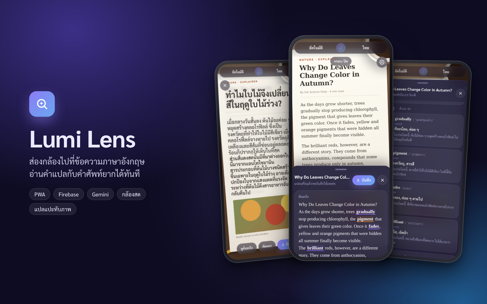
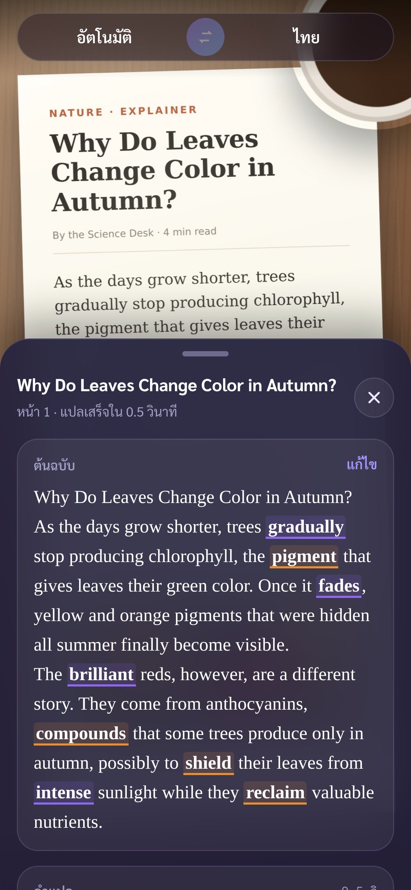
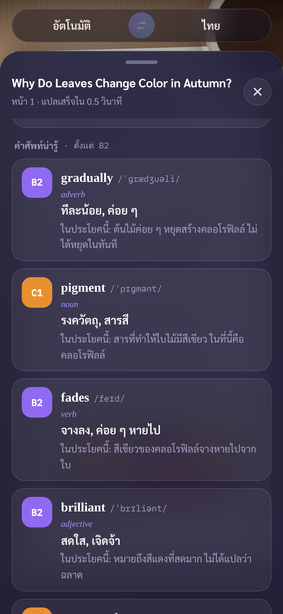
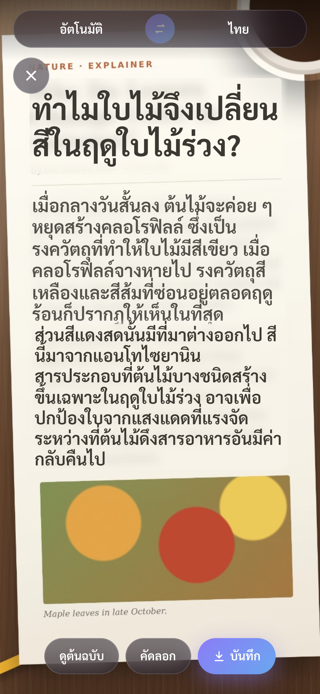
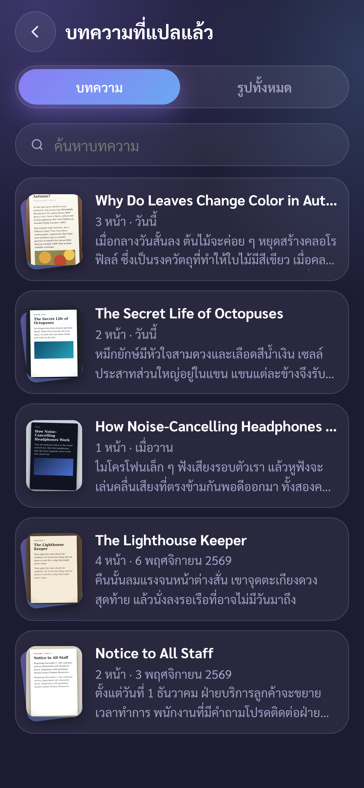
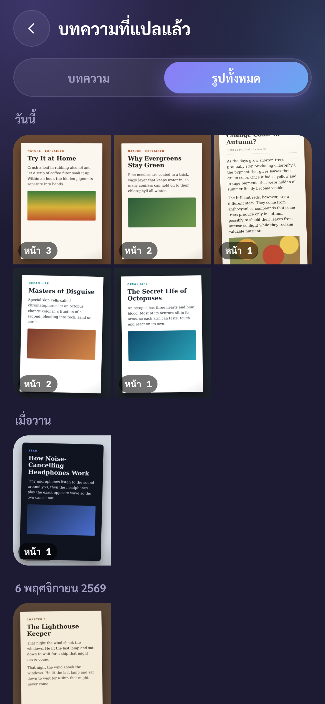
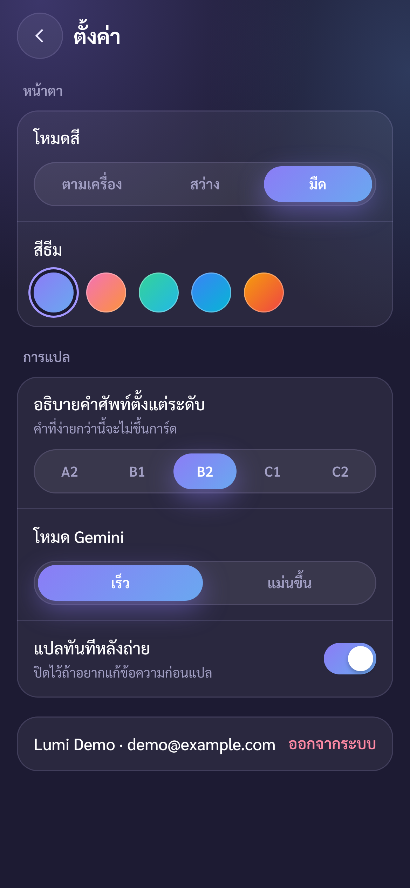
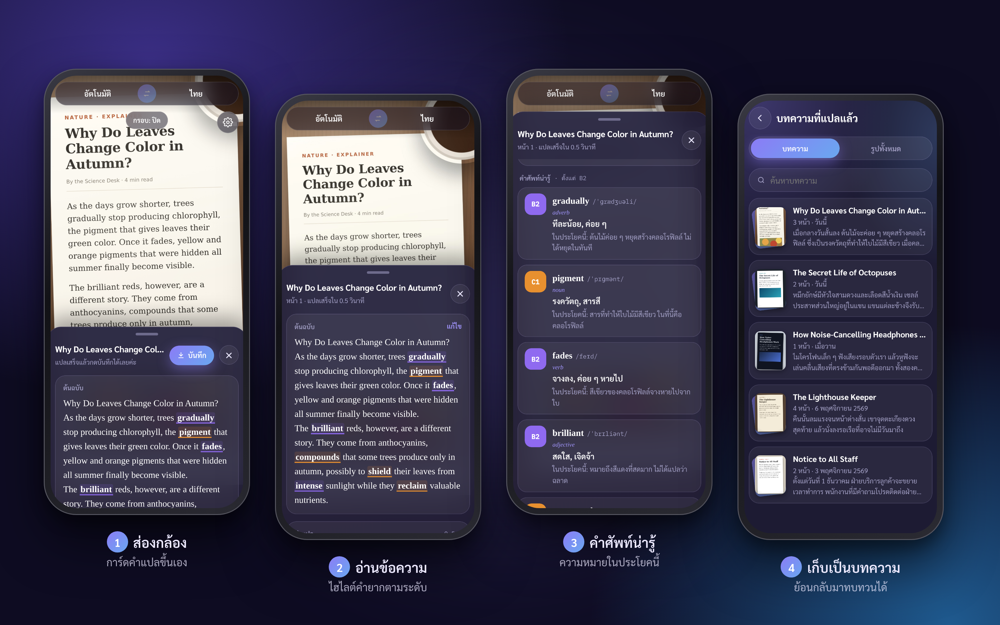
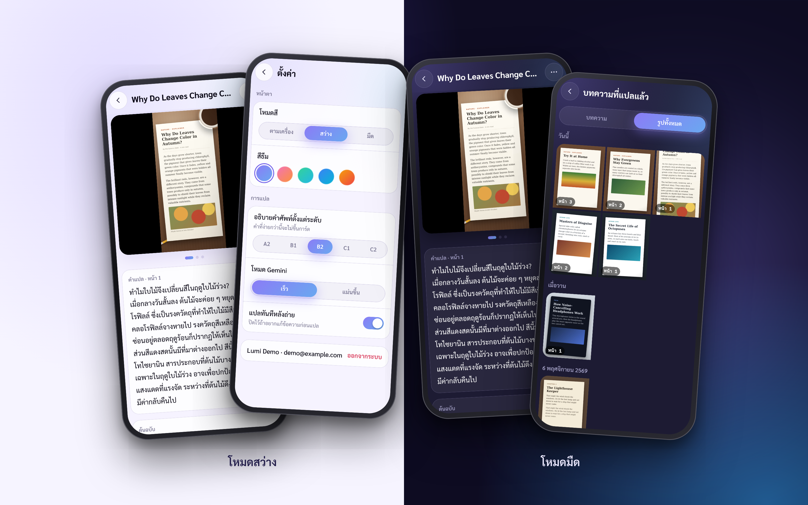

# Lumi Lens



**ส่องกล้องไปที่ข้อความภาษาอังกฤษ อ่านคำแปลกับคำศัพท์ยากได้ทันที**
*Point your phone camera at English text and get an instant Thai translation plus explanations of the hard words.*

🔗 **ลองใช้งาน:** https://lumi-lens.web.app (เปิดในมือถือ แล้วกด "เพิ่มลงในหน้าจอหลัก" เพื่อใช้เป็นแอป)

---

## ทำอะไรได้บ้าง

- **กล้องสด** — ส่องหน้าหนังสือ จอคอม หรือป้าย แล้วกด "แปลเลย" ระบบอ่านข้อความจากภาพและแปลเป็นไทยทั้งประโยค
- **แปลแบบการ์ด หรือแปะทับภาพ** — ดูคำแปลเป็นการ์ดอ่านง่าย หรือให้คำแปลวางทับตำแหน่งเดิมบนภาพเหมือนป้ายเปลี่ยนภาษา
- **คำศัพท์ยาก** — ไฮไลต์คำที่ยากกว่าระดับของผู้ใช้ พร้อมคำอ่าน (IPA) ชนิดคำ ความหมาย และความหมายในประโยคนั้น ๆ แบ่งสีตามระดับ CEFR (A1–C2)
- **ปรับระดับผู้เรียน** — เลือกระดับ A2–C2 เพื่อให้ระบบเลือกคำที่ควรอธิบายได้เหมาะกับคนอ่าน
- **คลังบทความ** — บันทึกบทความที่แปลแล้ว สแกนหน้าต่อไปเข้าบทความเดิมได้ ดูรูปทั้งหมด เปลี่ยนชื่อ หรือลบได้
- **โหมดเร็ว / โหมดแม่นขึ้น** — สลับรุ่นโมเดลตามความต้องการ
- **ธีมสว่าง / มืด / ตามเครื่อง** และติดตั้งเป็นแอปบนมือถือได้ (PWA)

## ภาพหน้าจอ

| กล้องสด | ผลการแปล | คำศัพท์ | แปะทับภาพ |
|---|---|---|---|
|  |  |  |  |

| คลังบทความ | รูปทั้งหมด | อ่านบทความ | ตั้งค่า |
|---|---|---|---|
|  |  |  |  |




## เทคโนโลยีที่ใช้

| ส่วน | เครื่องมือ |
|---|---|
| หน้าแอป | HTML, CSS, JavaScript (ไม่ใช้เฟรมเวิร์ก), PWA + Service Worker |
| AI อ่านภาพและแปล | Gemini ผ่าน Firebase AI Logic (`firebase/ai`) |
| ล็อกอิน | Firebase Authentication (Google) |
| ฐานข้อมูล | Cloud Firestore (เก็บแคชออฟไลน์ในเครื่องด้วย) |
| โฮสต์ | Firebase Hosting |
| Build | esbuild |

## โครงสร้างโปรเจกต์

```
src/main.js            โค้ดหลักของแอป (กล้อง, เรียก Gemini, คลังบทความ, ตั้งค่า)
public/                ไฟล์หน้าเว็บที่ขึ้นโฮสต์ (index.html, style.css, sw.js, manifest, icons)
firestore.rules        กฎความปลอดภัย: ผู้ใช้แต่ละคนอ่าน/เขียนได้เฉพาะข้อมูลของตัวเอง
firebase.json          ตั้งค่า Hosting และ Firestore
screenshots/           ภาพหน้าจอ
```

## รันเอง

```bash
npm install
npm run build        # รวม src/main.js -> public/app.js
npx firebase-tools deploy
```

> ต้องมีโปรเจกต์ Firebase ของตัวเอง ที่เปิด Authentication (Google), Firestore และ Firebase AI Logic ไว้ แล้วแก้ `firebaseConfig` ใน `src/main.js` และ `.firebaserc`

## ผู้พัฒนา

Soravis — [@SoravisLNH](https://github.com/SoravisLNH)
